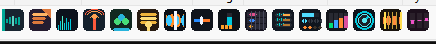
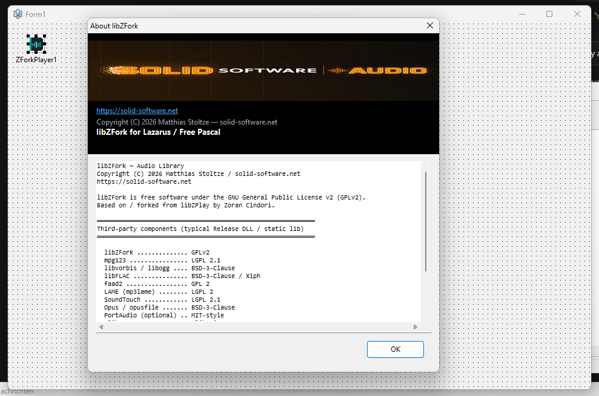
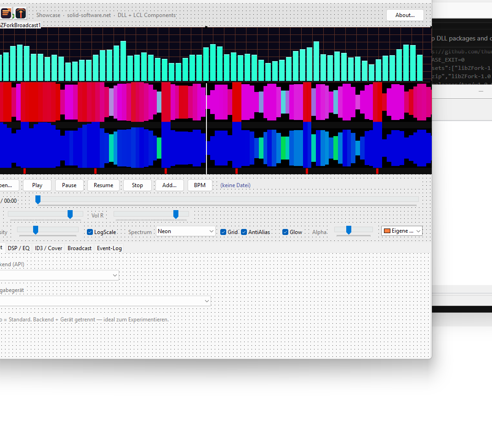
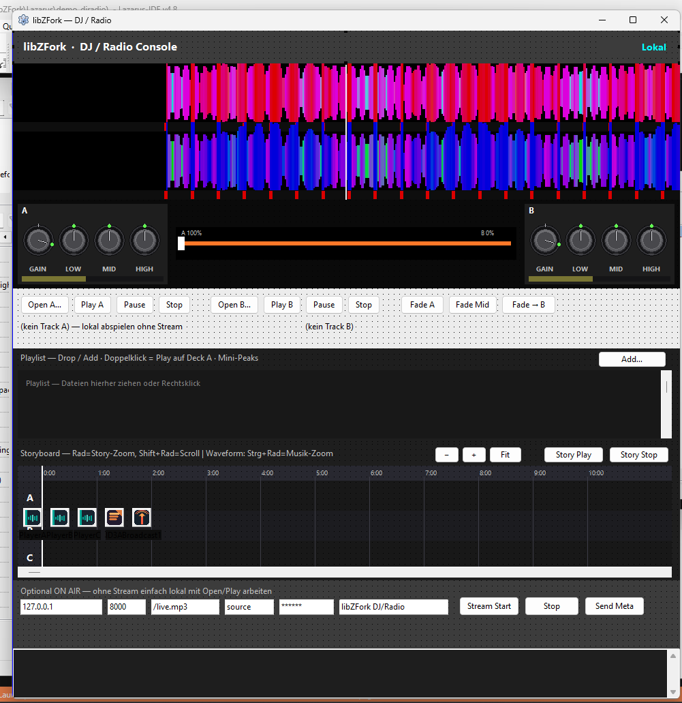
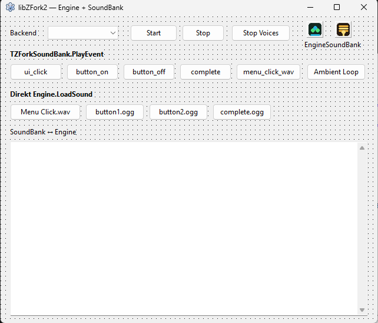
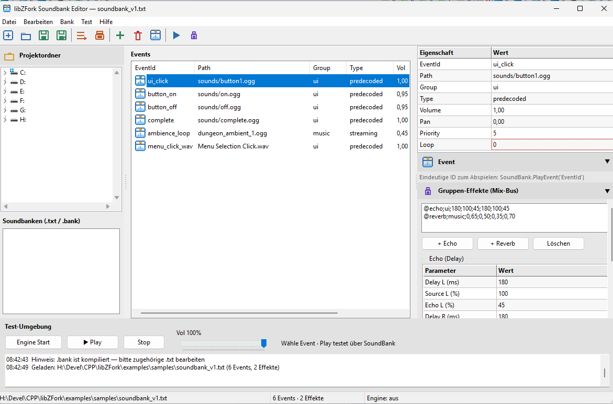

# libZFork

**Modern C++20 audio engine** for Windows & Linux — player, DSP, game audio, DJ/radio, Lazarus components.

Copyright (C) 2026 [Matthias Stoltze](https://solid-software.net) · **GPLv2**  
SDK / Downloads: [libZFork-sdk Releases](https://github.com/thunderbird2013/libZFork-sdk/releases)  
Dev-Repo: [thunderbird2013/libZFork](https://github.com/thunderbird2013/libZFork)



---

## Entstehung

libZFork ist ein **Fork / Neubau** von [**libZPlay 2.02**](http://libzplay.sourceforge.net/) von **Zoran Cindori** (GPLv2).

Neu geschrieben als:

- reines **C++20** (kein Legacy-API-Mix)
- Dependencies über **vcpkg**, sauberes **CMake**-Build
- **self-contained** `libZFork.dll` / `.so` (Codecs & DSP **statisch** eingebunden)
- parallele APIs: **C++**, **C-ABI** (`zfork_*` / `zfork2_*`), Bindings für **C#**, **Pascal**, **PureBasic**, **Lazarus-Komponenten**



---

## Was die Library kann

### Player (libZFork / `zfork_*`)

| Bereich | Features |
|--------|----------|
| **Wiedergabe** | Play / Pause / Stop / Seek / Loop / Gapless-Playlist |
| **Formate** | MP3, OGG, FLAC, WAV/PCM, AAC/ADTS, M4A, Opus, AIFF, Audio-CD (Windows) |
| **DSP** | 31-Band-EQ, Echo/Delay, Reverb, Vocal-/Side-Cut, Stereo-Enhance |
| **Pitch / Tempo** | SoundTouch (Rate, Semitone-Pitch, Tempo unabhängig) |
| **Analyse** | FFT / Spektrum, BPM, VU |
| **Metadaten** | ID3v1/v2 (inkl. Cover, TKEY/Camelot), Vorbis Comments |
| **Encoding** | Parallel encode: MP3, OGG, FLAC, WAV |
| **Broadcast** | Icecast/Shoutcast (libshout, optional separat) |
| **Ausgabe** | WaveOut / WASAPI (Windows), PortAudio (Linux), Null |

### Game-Audio / Engine (libZFork2 / `zfork2_*`)

- Multi-Voice Mixer, Channel-Groups, Prioritäten, Loop
- **SoundBank** (`.txt` / kompiliertes `.bank`) mit Events, Gruppen, Echo/Reverb-Directives
- Spatial / Pan / Volume, Streaming & PreDecoded Voices

### Lazarus / Free Pascal

Design-Time-Komponenten: Player, Spectrum, Waveform, Deck, Mixer, Jog, BeatGrid, EQ, Playlist, Storyboard, Broadcast, AudioEngine, SoundBank, …



*Showcase — Player, Spektrum, DSP/EQ, ID3, Broadcast*



*DJ / Radio — Dual-Deck, Crossfader, Storyboard, On-Air*



*libZFork2 — Engine + SoundBank Events*



*Soundbank Editor — Events, Gruppen-FX, Test-Engine*

---

## Systemvoraussetzungen

### Runtime (Anwendung mit DLL)

| Plattform | Architektur | Benötigt |
|-----------|-------------|----------|
| **Windows** 10/11 | **x64** | `libZFork.dll` (Release) bzw. `libZForkd.dll` (Debug) |
| **Linux** | x64 / arm64 | `libZFork.so` (Symlinks `.so.1` / `.so.1.0.0`) |
| Lazarus/FPC | Win64 | Package `lazlibzfork` + DLL neben der EXE |

Die **Release-DLL ist self-contained**: keine zusätzlichen Codec-DLLs (mpg123, faad, …) nötig — alles ist **statisch** in `libZFork.dll` / `.so` eingebaut.

Optional zusätzlich (nur wenn genutzt):

- Broadcast: `libshout.dll` / `libshout-3.dll` (Windows)

### Entwickeln / Neu bauen

| Tool | Hinweis |
|------|---------|
| CMake ≥ 3.25 | |
| Visual Studio 2022 Build Tools **oder** GCC/Clang (Linux) | |
| vcpkg | Variable `VCPKG_ROOT` bzw. `.\build.ps1 -VcpkgRoot …` |
| WSL (optional) | Linux x64 / arm64 Cross-Build |

```powershell
.\build.ps1 -Config Both -Link Both
```

---

## Wo liegen die DLLs / Libs?

### GitHub Release (Download)

→ [libZFork-sdk Releases v1.0.0](https://github.com/thunderbird2013/libZFork-sdk/releases/tag/v1.0.0)

| Asset | Inhalt |
|-------|--------|
| `libZFork-1.0.0-win-x64.zip` | Windows DLL + `.lib` + static (Release+Debug) |
| `libZFork-1.0.0-linux-x64.zip` | Linux x64 `.so` / `.a` |
| `libZFork-1.0.0-linux-arm64.zip` | Linux arm64 |
| `libZFork-1.0.0-sdk.zip` | Komplettes SDK |

### Im SDK-Repo / `dist\`

```
win-x64/Release/libZFork.dll      ← normal für Apps
win-x64/Release/libZFork.lib      ← Import-Lib (MSVC)
win-x64/Release/libZFork_static.lib
win-x64/Debug/libZForkd.dll
linux-x64/Release/libZFork.so*
linux-arm64/Release/libZFork.so*
include/libzfork/                 ← Header
bindings/                         ← C# / Pascal / PureBasic
lazarus/                          ← Lazarus-Package
license/                          ← Pflicht-Lizenztexte
source/                           ← Corresponding Source (GPLv2)
```

**Windows-App:** `libZFork.dll` **neben die EXE** legen (gleicher Ordner).

---

## Eingebettete Bibliotheken (in der DLL kompiliert)

Die Release-DLL/SO enthält u. a. **statisch** gelinkt:

| Bibliothek | Zweck | Lizenz |
|------------|--------|--------|
| **libZFork** (dieser Code) | Audio-Engine | **GPLv2** |
| **faad2** | AAC / M4A Decode | **GPL** |
| **mpg123** | MP3 Decode | **LGPL 2.1** |
| **LAME (mp3lame)** | MP3 Encode | **LGPL 2.1** |
| **SoundTouch** | Pitch / Tempo / Rate | **LGPL 2.1** |
| **libvorbis / libogg** | OGG Vorbis | BSD-3-Clause |
| **libFLAC** | FLAC | BSD / Xiph |
| **opus / opusfile** | Opus | BSD-3-Clause |
| **PortAudio** | Capture / Linux I/O | MIT-ähnlich |
| **zlib / libpng / libjpeg** | Tags / Cover-Art | zlib / libpng / IJG |

Volltexte: Ordner [`license/`](license/) bzw. im SDK unter `license/`.

---

## Was du bei Weitergabe mitgeben musst (Lizenzen)

Weil die DLL **GPLv2**-Code (libZFork + faad2) und **LGPL**-Libs enthält:

1. **`license\`-Ordner mitliefern** (GPL.TXT, LGPL.TXT, faad.txt, SoundTouch.txt, …) — z. B. neben der EXE  
2. **Corresponding Source** anbieten — liegt im SDK unter `source\` bzw. in diesem Git-Repo  
3. Eigenen Code, der **gegen libZFork gelinkt** und **weitergegeben** wird, unter **GPLv2**-kompatiblen Bedingungen veröffentlichen (typisch: ebenfalls GPLv2)

Kurz: App + `libZFork.dll` + `license\` (+ Source-Angebot) = GPL-konforme Weitergabe.

---

## Schnellstart

> **C++** und **Pascal-Bindings** nutzen dieselbe DLL.  
> **Visuelle Komponenten** (Player, Spectrum, Deck, …) gibt es **nur für Lazarus**.  
> Unter `examples/` liegen viele **C++-Templates/Demos**; Lazarus-Demos unter `Lazarus/demo*`.

### C / C++

```c
#include <libzfork/libzfork.h>
/* Link: libZFork.lib  —  Runtime: libZFork.dll neben die EXE */
```

Beispiele: Ordner [`examples/`](examples/) (Player, EQ, Broadcast, zfork2, …).

### Lazarus — Komponenten (GUI)

1. **Package → Open** → `lazarus/lazlibzfork.lpk` → **Compile** → **Use → Install**  
2. Palette **libZFork** → Komponenten aufs Formular  
3. `libZFork.dll` (x64) **neben die EXE** kopieren  

### Lazarus / Free Pascal — Console **ohne** Komponenten (Bindings)

Unit aus dem SDK: `bindings/pascal/libzfork.pas` (bzw. `Lazarus/LibZFork.pas`) zum Projekt hinzufügen.  
`libZFork.dll` muss im Arbeitsverzeichnis / neben der EXE liegen.

#### Beispiel 1 — Datei abspielen (Player-API)

```pascal
program PlayFile;
{$mode objfpc}{$H+}
uses
  SysUtils, libzfork;

var
  H: TZFORK_HANDLE;
  St: TStreamStatus;
begin
  H := zfork_Create;
  if H = nil then
  begin
    WriteLn('zfork_Create fehlgeschlagen');
    Halt(1);
  end;

  if not ZForkOpenFile(H, 'music.mp3') then
  begin
    WriteLn('Open: ', ZForkGetError(H));
    zfork_Destroy(H);
    Halt(1);
  end;

  if not ZForkPlay(H) then
  begin
    WriteLn('Play: ', ZForkGetError(H));
    zfork_Destroy(H);
    Halt(1);
  end;

  WriteLn('Playing — Strg+C zum Abbrechen');
  repeat
    Sleep(100);
    FillChar(St, SizeOf(St), 0);
    zfork_GetStatus(H, @St);
  until not St.playing;

  zfork_Destroy(H);
end.
```

#### Beispiel 2 — Kurzsound über Engine (libZFork2)

```pascal
program PlaySfx;
{$mode objfpc}{$H+}
uses
  SysUtils, libzfork2;

var
  Ctx: TZF2_CONTEXT;
  Snd: TZF2_SOUND;
  I: Integer;
begin
  Ctx := zfork2_CreateContext;
  if Ctx = nil then Halt(1);

  Snd := zfork2_LoadSound(Ctx, PWideChar(UnicodeString('click.wav')),
                          ZF2_SOUND_PREDECODED);
  if Snd = nil then
  begin
    WriteLn('LoadSound fehlgeschlagen');
    zfork2_DestroyContext(Ctx);
    Halt(1);
  end;

  zfork2_PlaySound(Ctx, Snd, nil);  { Gruppe nil = Default }
  for I := 1 to 50 do
  begin
    zfork2_Update(Ctx);             { Mixer tick — in GUI: Timer }
    Sleep(20);
  end;

  zfork2_UnloadSound(Snd);
  zfork2_DestroyContext(Ctx);
end.
```

`uses libzfork2;` → Datei `bindings/pascal/libzfork2.pas`.

### Download nur Binaries

[Release v1.0.0](https://github.com/thunderbird2013/libZFork-sdk/releases/tag/v1.0.0) → passendes Zip wählen.

---

## Version

Zentrale Versionsdatei: [`VERSION`](VERSION) (aktuell **1.0.0**).  
DLL-Dateiversion, Header `libzfork_version.h`, Lazarus-Package und Installer lesen dieselbe Quelle.

---

## Links

- Homepage: https://solid-software.net  
- SDK-Repo: https://github.com/thunderbird2013/libZFork-sdk  
- Hilfe (CHM): im SDK unter `help/libZFork.chm`  
- Original libZPlay: http://libzplay.sourceforge.net/
